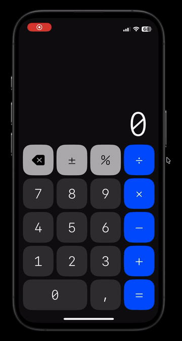
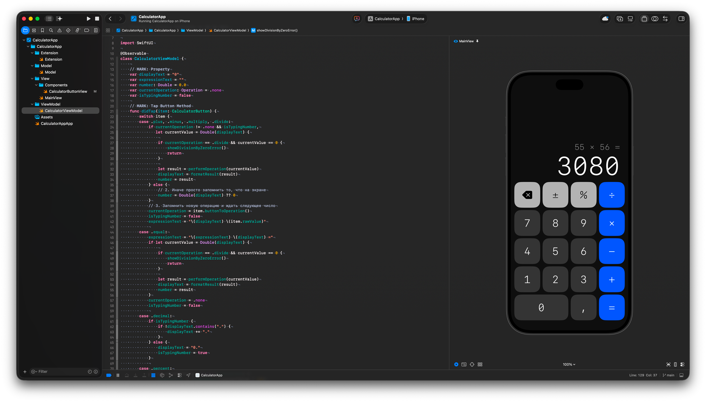

# Calculator

A minimalist iOS calculator built with SwiftUI — designed in Figma and implemented from scratch as a pet project to practice modern iOS development: clean MVVM architecture, reusable components and micro-animations.

<p align="center">
  
</p>

## Features

- Basic arithmetic: addition, subtraction, multiplication, division
- Operation chaining — `2 + 3 + 4 =` calculates step by step
- Expression line above the result, e.g. `12 + 7 =`
- Backspace: deletes the last digit while typing, clears everything otherwise
- Decimal input, sign change (±) and percent
- Division by zero handling
- Input limit (9 digits) and auto-scaling display text
- Clean number formatting without scientific notation
- Animated digits, button press animation and haptic feedback
- Dark theme, portrait orientation

## In Xcode

<p align="center">
  
</p>

## Tech Stack

| Area | Tools |
|---|---|
| Language | Swift |
| UI | SwiftUI |
| Architecture | MVVM |
| State management | Observation (`@Observable`), `@State`, `@Environment` |
| Layout | `Grid` / `GridRow`, `layoutPriority`, baseline alignment |
| Components | Reusable button view, custom `ButtonStyle`, `@ViewBuilder` |
| Modeling | Enums with raw values and computed properties |
| Animations | `contentTransition(.numericText())`, spring animations |
| Feedback | `sensoryFeedback` (haptics) |
| Formatting | `FormatStyle` (`.formatted(.number)`) |
| Design | Figma, UX/UI, color tokens in Asset Catalog |
| Version control | Git, GitHub |

## Architecture

```
CalculatorApp
├── Model
│   └── Model.swift                  # Button and operation enums
├── ViewModel
│   └── CalculatorViewModel.swift    # Calculation logic and state
├── View
│   ├── MainView.swift               # Main screen: display + keypad
│   └── Components
│       └── CalculatorButtonView.swift  # Reusable button + press style
└── Extension
    └── Extension.swift
```

- **Model** describes *what* a button is (digit, operation, function) — no UI code
- **ViewModel** holds all logic and state: display text, stored number, current operation, input state
- **View** only displays data and forwards taps to the ViewModel

## What I Learned

- Managing app state with `@Observable` and keeping a single source of truth
- Modeling a calculator as a state machine (typing vs. showing a result)
- Handling edge cases: chained operations, division by zero, decimal input, input limits
- Separating responsibilities between Model, ViewModel and View
- Building reusable components and a custom `ButtonStyle`
- Adaptive layout with `Grid` instead of manual screen-size calculations
- Adding micro-animations and haptics with a few modifiers
- Refactoring in small steps with meaningful Git commits

## Requirements

- iOS 17.0+
- Xcode 16+

## Getting Started

1. Clone the repository
2. Open `CalculatorApp.xcodeproj` in Xcode
3. Select an iPhone simulator or device and press **Run** (⌘R)

## Author

**Valeriy Protsenko** — iOS Design Engineer  
[LinkedIn](https://www.linkedin.com/in/valprotsenko) · [Website](https://lerix.pro/?lang=en) · [Telegram](https://t.me/vallerqq)
